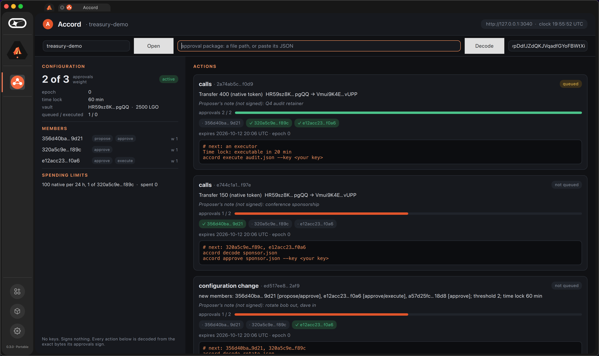

# Accord mini-app

A QML view of a multisig and its approval packages. It holds no keys and
signs nothing: it reads the configuration and queued records from the chain,
decodes each package's action from the exact bytes its approvals sign
(recomputing the digest and refusing a package whose digest does not match),
shows who has approved and what the threshold needs, the time lock against
the chain's clock, and the exact `accord` command for whoever's turn it is.



That is the module loaded in the real Basecamp 0.3.0 (`Successfully loaded UI
module: "accord"`), the multisig id and four package paths typed into it: a
queued transfer in its time lock, a transfer waiting for approvals, a
configuration change, and a tampered copy, refused as a digest mismatch.

- `src/accord_chain.{h,cpp}`: the reader (Qt Core and Network): JSON-RPC,
  base58, PDAs, borsh decoders for the configuration, queued records and
  actions, the digest.
- `src/qml/Main.qml`: the view; `logos.module("accord")` is its backend, as in
  a Basecamp `ui_qml` module.
- `tests/chain_test.cpp`: the reader against the Rust program, offline:
  every stored-account vector of the core crate, the PDAs the CLI derives,
  a package from the live room run, and a tampered copy (13 checks).
- `tests/qml_host.cpp`: the real view outside Basecamp against a live node,
  for screenshots; fails on any QML warning.

```bash
cmake -S app/tests -B build/app -DCMAKE_PREFIX_PATH=$(brew --prefix qt) && cmake --build build/app
build/app/chain_test app/tests/fixtures
build/app/qml_host app/src/qml/Main.qml 1280 900 out.png --rpc http://127.0.0.1:3040 \
  --program <header> --multisig <id> [--name <key>=alice ...] package.json ...
```

## Install in Basecamp

`app/accord.lgx` is built by the Logos module builder (`app/flake.nix`):

```bash
nix build ./app#lgx-portable --accept-flake-config -o app/result   # app/result/logos-accord-module.lgx
scripts/install-local.sh /tmp/bc app/result/logos-accord-module.lgx
ACCORD_RPC=http://127.0.0.1:3040 ACCORD_PROGRAM=<header> LogosBasecamp --user-dir /tmp/bc
```

`ACCORD_RPC` and `ACCORD_PROGRAM` win over the settings saved under
`$LOGOS_USER_DIR/module_data/accord/`; the program field in the bar saves one.
The default node is `https://testnet.lez.logos.co`.
